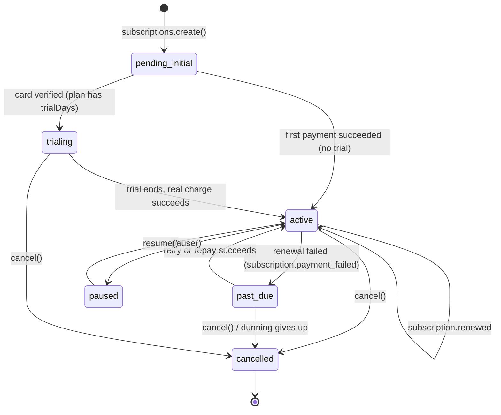

# Aslan Payment PHP SDK

Official PHP SDK for the [Aslan Payment API](https://aslanpay.ma): accept card payments, share payment links, issue refunds, bill customers on a recurring basis (subscriptions), and receive signed webhook events.

- Package: `aslan/payment-php` (version **0.2.0**)
- API base URL: `https://api.aslanpay.ma/pay`
- Language: PHP, framework-agnostic (uses Symfony HttpClient under the hood)
- Using Laravel? Use the dedicated integration instead: [`aslan/payment-laravel`](https://github.com/Belkouche/aslan-payment-laravel).
- Writing code with an AI coding agent? Jump to [For LLM coding agents](#11-for-llm-coding-agents) (also see [`AGENTS.md`](AGENTS.md) and [`llms.txt`](llms.txt)).

> **Still on 0.1.0? Upgrade now.** In 0.1.0 the exception class `AslanException` could not even be loaded (PHP raised a fatal error), so every error path of the SDK crashed instead of throwing a catchable exception. 0.2.0 fixes this. See [Upgrading from 0.1.0](#13-upgrading-from-010).

## Table of contents

1. [What this is and who it is for](#1-what-this-is-and-who-it-is-for)
2. [Requirements and why PHP must be patched](#2-requirements-and-why-php-must-be-patched)
3. [Installation](#3-installation)
4. [Concepts in 2 minutes](#4-concepts-in-2-minutes)
5. [Quick start: a one-time payment](#5-quick-start-a-one-time-payment)
6. [Subscriptions, step by step](#6-subscriptions-step-by-step)
7. [Webhooks in depth](#7-webhooks-in-depth)
8. [Errors and retries](#8-errors-and-retries)
9. [Testing your integration](#9-testing-your-integration)
10. [API reference](#10-api-reference)
11. [For LLM coding agents](#11-for-llm-coding-agents)
12. [Security checklist](#12-security-checklist)
13. [Upgrading from 0.1.0](#13-upgrading-from-010)
14. [Changelog, license, support](#14-changelog-license-support)

---

## 1. What this is and who it is for

This SDK is a thin, typed PHP wrapper around the Aslan Payment API. You, the merchant, run a website or backend; Aslan runs the payment page and talks to the card networks. Your code never sees a card number.

Typical flows:

| You want to... | You use... |
|---|---|
| Charge a customer once, for an order | a **checkout session** (section 5) |
| Share a reusable "pay me" URL (invoice, donation, QR code) | a **payment link** |
| Charge a customer every month/year | a **plan** + a **subscription** (section 6) |
| Give money back | a **refund** |
| Know that a payment really happened | a **webhook** (section 7) |

The SDK is organised as one main class, `Aslan\Payment\Aslan`, with one property per API resource (`$aslan->checkoutSessions`, `$aslan->subscriptions`, ...). Every method returns a typed, read-only object (a DTO) such as `CheckoutSession` or `Subscription`; there are no raw arrays to guess at (webhook payloads are the one place where you also get the raw array, in `$event->data`).

---

## 2. Requirements and why PHP must be patched

| Requirement | Constraint | Where it is enforced |
|---|---|---|
| PHP | `~8.2.35 \|\| ~8.3.36 \|\| ~8.4.27 \|\| >=8.5.12` | `composer.json` |
| `symfony/http-client` | `^6.4.15 \|\| ^7.4 \|\| ^8.1` | `composer.json` |
| `symfony/contracts` | `^3.5` | `composer.json` |
| PHPUnit (dev only) | `^11.5.50` | `composer.json` |

### Why PHP >= 8.x.y? (read this, it is short)

On **2026-10-21** the PHP project released **8.5.12, 8.4.27, 8.3.36 and 8.2.35**. These releases fix two critical, unauthenticated **remote code execution** (RCE) flaws:

- **CVE-2026-109618**: out-of-memory corruption
- **CVE-2026-109619**: stale global state

Together they are nicknamed **"php2shell"** (CVSS v4 score 9.2, i.e. "critical"). They were publicly disclosed *before* the fix existed, so attackers had a head start. "Unauthenticated RCE" means a stranger on the internet can make your server run code of their choosing, without logging in.

A payment integration holds the keys to money: your API secret key and your webhook secret live on that server. An attacker who runs code there can read both. So this SDK takes a firm stance: **it refuses to install on a PHP version that is vulnerable.**

Sources:

- [PHP release announcement](https://news-web.php.net/php.announce/509)
- [PHP supported versions](https://www.php.net/supported-versions.php)
- [Help Net Security coverage](https://www.helpnetsecurity.com/2026/10/21/php2shell-php-vulnerabilities-patched-cve-2026-109618-cve-2026-109619/)

### How to read the constraint

`~8.3.36` means "8.3.36 **or later 8.3.x**, but not 8.4". The four alternatives are OR-ed together, one per supported PHP line:

| Your PHP line | Minimum accepted version |
|---|---|
| 8.2.x | 8.2.35 |
| 8.3.x | 8.3.36 |
| 8.4.x | 8.4.27 |
| 8.5.x and later | 8.5.12 |
| 8.1 or older | not supported (also end-of-life) |

### What Composer does about it

- `composer require` / `composer install` **refuses to install** the SDK on a vulnerable PHP and tells you which platform requirement failed.
- Composer also generates a runtime `platform_check` in `vendor/composer/`, but it only enforces the **lowest bound (8.2.35)**, not the per-line floors. Do not rely on it: **keep the PHP that actually serves your site patched**, not just the one that ran `composer install` on a build machine.

### Check and fix your PHP

```bash
php -v          # e.g. "PHP 8.4.27 (cli) ..." -> OK;  "PHP 8.4.25" -> too old
composer check-platform-reqs
```

To upgrade, use your OS package manager or image (for example a newer official `php:8.4` Docker tag, or your distribution's security update), then restart PHP-FPM / Apache / your worker processes. Check `php -v` for the *web* PHP too (`php-fpm -v`), since the CLI and FPM can differ.

**Interim mitigation (only if you cannot upgrade immediately):** set `session.upload_progress.enabled=0` in `php.ini`. This blocks the *known* exploitation paths of the second flaw. It does **not** cover all variants and does not replace upgrading.

### End of life for PHP 8.2

PHP 8.2 reaches **end of life on 2026-12-31**; after that it gets no security fixes. New projects should use **PHP 8.4 or 8.5**.

### The other version floors, and why

- `symfony/http-client ^6.4.15 || ^7.4 || ^8.1`: 6.4 is an LTS line that still receives patches; 7.4 and 8.1 are current. The `6.4.15` floor excludes versions affected by CVE-2024-50342.
- `symfony/contracts ^3.5`: the contracts line shared by the maintained Symfony versions.
- PHPUnit `^11.5.50` (development only): the floor excludes CVE-2026-24765. PHPUnit 11 is the last major that still runs on PHP 8.2.

Run `composer audit` in your CI so that known-vulnerable dependencies fail the build:

```bash
composer audit
```

---

## 3. Installation

```bash
composer require aslan/payment-php
```

If the package is not on Packagist yet, install it straight from GitHub by adding a VCS repository to your `composer.json`, then requiring it:

```json
{
    "repositories": [
        { "type": "vcs", "url": "https://github.com/Belkouche/aslan-payment-php-symfony" }
    ]
}
```

```bash
composer require aslan/payment-php
```

Then create the client once and reuse it:

```php
<?php
require __DIR__ . '/vendor/autoload.php';

use Aslan\Payment\Aslan;

$aslan = new Aslan(getenv('ASLAN_SECRET_KEY')); // sk_test_... or sk_live_...
```

Constructor arguments (all but the key are optional):

| Argument | Type | Default | Meaning |
|---|---|---|---|
| `$secretKey` | `string` | required | `sk_live_...` or `sk_test_...`. Any other prefix throws `AslanException` with code `AUTHENTICATION_ERROR` |
| `$baseUrl` | `string` | `https://api.aslanpay.ma/pay` | Override only for special environments |
| `$timeout` | `int` | `30` | Request timeout in seconds |
| `$maxRetries` | `int` | `2` | Automatic retries on transient errors |
| `$httpClient` | `?HttpClientInterface` | Symfony client | Inject your own (tests, other HTTP libraries) |

Helpers: `$aslan->isTestMode()`, `$aslan->isLiveMode()`, `$aslan->getBaseUrl()`.

---

## 4. Concepts in 2 minutes

### Keys and modes

You authenticate with a secret key sent as `Authorization: Bearer sk_...` (the SDK does this for you). **Test or live mode is decided only by the key prefix**:

| Prefix | Mode | Money moves? |
|---|---|---|
| `sk_test_...` | test | No. Safe for development |
| `sk_live_...` | live | Yes. Real customers, real money |

There is no "mode" flag to set. Switch key, switch mode. Keep keys in environment variables, never in source control.

### Amounts are integers in centimes

All amounts are **integers in centimes** (1/100 of a dirham). The currency is **MAD**.

| You want to charge | You send |
|---|---|
| 149.00 MAD | `14900` |
| 50.00 MAD | `5000` |
| 0.50 MAD | `50` |

Never send floats (`149.0`, `"149.00"`). Convert once at the edge: `(int) round($priceInMad * 100)`.

### Checkout session vs payment link vs subscription

- **Checkout session**: a single-use, time-limited payment for one order. You create it, redirect the customer to `$session->url`, done.
- **Payment link**: a reusable, shareable URL (optionally with a QR code, a usage limit, an expiry). Good for invoices and donations.
- **Subscription**: a customer pays a **plan** automatically every interval until cancelled. Needs a customer who saves a card once.

### Webhooks are the source of truth

When the customer comes back to your `successUrl`, that only proves their *browser* arrived. It does not prove the payment succeeded: anyone can type that URL. The reliable signal is a **signed webhook** (`payment.succeeded`, ...) sent server-to-server to you. Mark an order as paid only when that webhook arrives and verifies. See [section 7](#7-webhooks-in-depth).

### Idempotency

Creating things over a network can fail halfway (timeout: did it work or not?). To retry safely, pass an **idempotency key**: the same key with the same request returns the same result instead of creating a duplicate. These `create()` methods accept an optional second argument `?string $idempotencyKey`:

`checkoutSessions->create`, `paymentLinks->create`, `refunds->create`, `vendors->create`, `apiKeys->create`, `webhooksConfig->create`.

```php
$session = $aslan->checkoutSessions->create($params, idempotencyKey: 'order_' . $orderId);
```

Plans and subscriptions do **not** take an idempotency key in this SDK: guard against double submission on your side (for example by storing the `subscriptionId` against your customer record first, and refusing to create a second one).

---

## 5. Quick start: a one-time payment

### Step 1: create a checkout session

```php
use Aslan\Payment\Aslan;
use Aslan\Payment\AslanException;

$aslan = new Aslan(getenv('ASLAN_SECRET_KEY'));

try {
    $session = $aslan->checkoutSessions->create([
        'amount'      => 14900,                       // 149.00 MAD
        'currency'    => 'MAD',
        'reference'   => 'order_1042',                // your own order id
        'description' => 'Order 1042 - Acme Store',
        'successUrl'  => 'https://shop.example/thanks',
        'cancelUrl'   => 'https://shop.example/cart',
        'metadata'    => ['orderId' => '1042'],
    ], idempotencyKey: 'order_1042');
} catch (AslanException $e) {
    error_log($e->getErrorCode() . ': ' . $e->getMessage());
    http_response_code(502);
    exit('Could not start the payment.');
}

header('Location: ' . $session->url);   // send the customer to the hosted payment page
exit;
```

**What happens:** the API creates a `CheckoutSession` (status `pending`, expires after `expiresIn` seconds, default 3600) and returns its hosted `url`. The customer pays on Aslan's page. Card data never touches your server.

`CheckoutSession` properties: `id`, `token`, `url`, `amount` (`?int`), `currency`, `status` (`pending | completed | expired | cancelled`), `openAmount`, `transactionId`, `reference`, `description`, `successUrl`, `cancelUrl`, `metadata`, `expiresAt`, `createdAt`, `updatedAt`. Helpers: `isPending()`, `isCompleted()`, `isExpired()`.

### Step 2: wait for the webhook

Do **not** mark the order paid on `successUrl`. Configure a webhook (section 7) and, when `payment.succeeded` arrives and verifies, mark order `1042` as paid, using the `reference`/`metadata` you stored.

### Step 3 (optional): look it up later

```php
$session     = $aslan->checkoutSessions->retrieve($sessionId);
$transaction = $aslan->transactions->retrieve($session->transactionId);   // Transaction
echo $transaction->status;   // pending | authorized | captured | failed | refunded | partially_refunded | voided
```

### Payment link example

```php
$link = $aslan->paymentLinks->create([
    'title'      => 'Support our association',
    'openAmount' => true,                 // the payer chooses the amount
    'successUrl' => 'https://asso.example/thanks',
]);
echo $link->url;                          // share it
$qr = $aslan->paymentLinks->getQrCode($link->id);   // array (see API reference)
```

### Refund example

```php
$refund = $aslan->refunds->create([
    'transactionId' => $transactionId,
    'amount'        => 5000,              // partial refund of 50.00 MAD; omit for a full refund
    'reason'        => 'customer_request',
], idempotencyKey: 'refund_1042_1');
```

**Common mistakes**

- Sending `149.00` or `"149"` instead of `14900`.
- Treating the redirect to `successUrl` as proof of payment.
- Forgetting that `openAmount` sessions have `amount === null`.
- Creating the `Aslan` client with a `pk_...` key (only `sk_live_` / `sk_test_` are accepted).

---

## 6. Subscriptions, step by step

### The big picture

```
 You                         Aslan API                    Customer
  |  1. plans->create()  ------>|                              |
  |  2. subscriptions->create -->|  (status: pending_initial)   |
  |<-- SubscriptionCheckout -----|                              |
  |  3. autoSubmitFormHtml() ----------------------------------> browser POSTs to Paywall
  |                              |<---- card + 3-D Secure ------|
  |<== webhook payment.succeeded |  (subscription becomes active / trialing)
  |                              |                              |
  |<== webhook subscription.renewed   every period, automatically
  |<== webhook subscription.payment_failed / past_due   when a renewal fails (dunning)
```

Lifecycle of the subscription `status`:



| Status | Meaning | What you should do |
|---|---|---|
| `pending_initial` | Created, first payment not completed yet | Do **not** grant access. If the customer abandoned the Paywall, call `repay()` |
| `trialing` | Card verified, free trial running | Grant access. The real charge happens at trial end |
| `active` | Paid up, renews automatically | Grant access |
| `past_due` | A renewal failed; Aslan is retrying (dunning) | Warn the customer; offer `changeCard()`. Decide your own grace policy |
| `paused` | Paused via `pause()` | Suspend access per your policy |
| `cancelled` | Ended | Revoke access |

The statuses are exposed as `Subscription::$status` (a nullable string). Helpers: `isActive()`, `isPastDue()`, `isCancelled()`.

### Step 1: create a plan (once)

A plan is the price list entry: how much, how often. Plans cannot be deleted, only archived. `amount` and `interval` are immutable after creation.

```php
$plan = $aslan->plans->create([
    'name'          => 'Pro (monthly)',
    'amount'        => 9900,          // 99.00 MAD per period, in centimes
    'currency'      => 'MAD',
    'interval'      => 'monthly',     // daily | weekly | monthly | quarterly | yearly
    'intervalCount' => 1,             // optional, 1-12 (every N intervals)
    'trialDays'     => 14,            // optional, 0 = no trial
    'metadata'      => ['tier' => 'pro'],
]);

echo $plan->id;                       // keep this uuid
```

`Plan` properties: `id`, `name`, `amount`, `currency`, `interval`, `intervalCount`, `trialDays`, `isActive`, `tvaRateBps` (`?int`), `metadata`, `createdAt`, `updatedAt`. Helper: `hasTrial()`.

Archive instead of delete: `$aslan->plans->update($plan->id, ['isActive' => false]);` (only `name`, `isActive`, `metadata` can change).

### Step 2: create the subscription

You need an Aslan **customer id** (`customerId`, a uuid; see `$aslan->customers`) and a **plan id**. Customers are created or matched by Aslan during payments; they are read-only through this SDK.

```php
$checkout = $aslan->subscriptions->create([
    'planId'      => $planId,
    'customerId'  => $customerId,
    'returnUrl'   => 'https://shop.example/billing/return',   // customer comes back here
    'cancelUrl'   => 'https://shop.example/billing/cancelled',
    'callbackUrl' => 'https://shop.example/billing/callback',
    'metadata'    => ['invoice_id' => 'INV-42'],
]);

// SAVE THIS NOW, before sending the customer away:
saveSubscriptionIdForCustomer($customerId, $checkout->subscriptionId);
```

`create()` returns a `SubscriptionCheckout` with: `subscriptionId`, `transactionId` (the initial charge; reported later by `payment.succeeded`), `redirectUrl` (the Paywall URL), and `paywall` (an array `['payload' => ..., 'signature' => ...]`).

Optional params: `priceOverride` (int centimes, between 1 and the plan amount), `priceOverrideMonths` (int, >= 1, limits how long the override applies), `metadata` (string map; keys starting with `__` are dropped). All three URLs (`returnUrl`, `cancelUrl`, `callbackUrl`) are required.

### Step 3: send the customer to the Paywall (form POST, not a redirect)

The Paywall expects the browser to **POST** the signed `payload` and `signature` to `redirectUrl`. A plain `header('Location: ...')` redirect is a GET and **will not work**. The SDK builds the right page for you:

```php
header('Content-Type: text/html; charset=utf-8');
echo $checkout->autoSubmitFormHtml();   // a tiny page that auto-submits the form
exit;
```

**What happens:** the customer lands on the Paywall, saves a card, completes 3-D Secure, and is sent back to your `returnUrl`.

- **No trial plan:** the first period is charged on the Paywall.
- **Trial plan:** only a small card-verification charge is made, and it is **refunded automatically**. The real charge happens when the trial ends.

### Step 4: wait for the webhook, then activate

The subscription stays `pending_initial` until the first payment succeeds. Do not grant access when the customer returns to `returnUrl`; wait for the verified `payment.succeeded` webhook (its `transactionId` matches `$checkout->transactionId`), then re-read the state if you need it:

```php
$sub = $aslan->subscriptions->retrieve($subscriptionId);   // Subscription
if ($sub->isActive() || $sub->status === 'trialing') {
    grantAccess($sub->customerId);
}
```

`Subscription` properties: `id`, `customerId`, `customer` (`?SubscriptionCustomer`: `id`, `email`, `name`, `phone`), `planId`, `plan` (`?Plan`), `providerId`, `status`, `failureCount`, `currentPeriodStart`, `currentPeriodEnd`, `nextBillingAt`, `trialEndsAt`, `cancelAtPeriodEnd`, `cancelledAt`, `priceOverride`, `priceOverrideUntil`, `metadata`, `card` (`?SubscriptionCard`: `brand`, `last4`, `expiryMonth`, `expiryYear`), `createdAt`, `updatedAt`.

If the customer abandoned the Paywall and the subscription is still `pending_initial`, mint a fresh link (see "Change card / repay" below).

### Step 5: renewals are automatic

On the **billing anchor day** of each period Aslan charges the saved card. You do nothing. On success you receive `subscription.renewed` (with the subscription and its `transaction` in `$event->data`); use it to extend access and to create your own invoice. Use `currentPeriodEnd` / `nextBillingAt` for "next payment on ..." messages.

### Step 6: dunning (failed renewals)

When a renewal charge fails Aslan does not give up at once. It retries ("dunning") and notifies you:

1. `subscription.payment_failed`: a charge attempt failed (a retry is scheduled). Tell the customer to update their card.
2. `subscription.past_due`: the subscription is now `past_due`. Apply your grace policy.
3. If the card is fixed in time (or a retry succeeds), you get `subscription.renewed` and the status goes back to `active`; otherwise the subscription can end up cancelled (you then get `subscription.cancelled`). The exact retry schedule is set by the API; do not hard-code assumptions about it.

`Subscription::$failureCount` counts the failures. Each charge is a **billing attempt**, listed with `$aslan->billingAttempts->list(['subscriptionId' => $id])`.

### Change card / repay

Both return a `SubscriptionPaymentLink` (`subscriptionId`, `paymentLinkId`, `redirectUrl`) and use a normal **GET redirect** (unlike the Paywall):

```php
$link = $aslan->subscriptions->changeCard($subscriptionId, [
    'returnUrl'   => 'https://shop.example/billing/return',
    'cancelUrl'   => 'https://shop.example/billing/cancelled',
    'callbackUrl' => 'https://shop.example/billing/callback',   // required, ignored by the API
]);
header('Location: ' . $link->redirectUrl);
```

- `changeCard()` re-collects the card with 3-D Secure (a small verification amount is charged and auto-refunded). Use it to fix a `past_due` subscription.
- `repay()` is for a subscription still in `pending_initial` whose first payment was never completed (API returns 400 for any other status).

### Change plan

```php
$change = $aslan->subscriptions->changePlan(
    $subscriptionId,
    $newPlanId,
    when: 'immediate',          // immediate | period_end | immediate_proration
    allowDowngrade: false,      // must be true to move to a cheaper plan (403 otherwise)
);
// SubscriptionPlanChange: subscriptionId, planId, previousPlanId, when,
// proratedTransactionId, proratedAmount, proratedCurrency
```

The card on file is reused. The result is confirmed by `subscription.plan_changed` or, if the charge fails, `subscription.plan_change_failed`.

### Price override

```php
$aslan->subscriptions->update($subscriptionId, ['priceOverride' => 7900, 'priceOverrideMonths' => 3]); // returns SubscriptionPriceOverride
$aslan->subscriptions->update($subscriptionId, ['priceOverride' => null]);                                // clear it
```

It takes effect at the **next renewal** (nothing is charged now) and is blocked on cancelled subscriptions.

### Cancel, uncancel, pause, resume

```php
$aslan->subscriptions->cancel($id);                       // cancel NOW
$aslan->subscriptions->cancel($id, atPeriodEnd: true);    // keep access until the period ends, then stop
$aslan->subscriptions->uncancel($id);                     // reverse a scheduled period-end cancellation
$aslan->subscriptions->pause($id);
$aslan->subscriptions->resume($id);
```

All four return a `SubscriptionStatusChange` (`subscriptionId`, `status`, `cancelAtPeriodEnd`). After `cancel($id, atPeriodEnd: true)` the status stays `active` with `cancelAtPeriodEnd === true` until the period ends; then `subscription.cancelled` fires. Re-read with `retrieve()` if you need the full state.

### Receipts and invoices

```php
$attempts = $aslan->billingAttempts->list(['subscriptionId' => $id, 'status' => 'succeeded']);
foreach ($attempts->data as $attempt) {            // BillingAttempt
    $doc   = $aslan->billingAttempts->receipt($attempt->id);       // DocumentData
    $bytes = $aslan->billingAttempts->receiptPdf($attempt->id);    // raw PDF string
    file_put_contents("receipt-{$attempt->id}.pdf", $bytes);
}
$invoice = $aslan->billingAttempts->facture($attempt->id);         // Invoice (facture mode only, idempotent)
$pdf     = $aslan->invoices->pdf($invoice->id);                    // raw PDF string
```

---

## 7. Webhooks in depth

### Why webhooks

Aslan calls **your** server when something happens. Because anyone could call your URL pretending to be Aslan, every delivery is **signed**. You verify the signature before trusting anything in it.

### Setup

Register one HTTPS endpoint per merchant (also possible from the dashboard). The signing secret is returned **only once**, at creation; store it as `ASLAN_WEBHOOK_SECRET`.

```php
$config = $aslan->webhooksConfig->create([
    'url'    => 'https://shop.example/webhooks/aslan',
    // 'events' => ['payment.succeeded', 'subscription.renewed'],   // omit or [] = all events
]);
echo $config->signingSecret;   // save it now; null on later reads
```

### The signature

Each delivery carries the header:

```
X-Webhook-Signature: t=1761127200,v1=5257a869e7ecebeda32affa62cdca3fa51cad7e77a0e56ff536d0ce8e108d8bd
```

- `t` is a Unix timestamp in seconds.
- `v1` is `HMAC-SHA256(secret, "<t>.<rawBody>")` as hex.
- The event name is in the JSON body's `event` field.
- Default tolerance is **300 seconds**: events whose `t` is further from now are rejected (replay protection).

### Verify against the RAW body

This is the number one cause of "signature mismatch". The signature covers the **exact bytes** Aslan sent. If you `json_decode()` and `json_encode()` again, spacing/key order/escaping change and the signature no longer matches. Read the raw body, verify it, then parse.

```php
use Aslan\Payment\Aslan;
use Aslan\Payment\AslanException;

$rawBody   = file_get_contents('php://input');                     // RAW, untouched
$sigHeader = $_SERVER['HTTP_X_WEBHOOK_SIGNATURE'] ?? '';

try {
    $event = Aslan::webhooks(getenv('ASLAN_WEBHOOK_SECRET'))
        ->constructEvent($rawBody, $sigHeader);                    // default tolerance 300 s
} catch (AslanException $e) {                                      // errorCode WEBHOOK_SIGNATURE_ERROR
    http_response_code(400);
    exit;
}
```

In Symfony use `$request->getContent()` and `$request->headers->get('X-Webhook-Signature', '')`. In any framework, make sure no middleware consumed or rewrote the body first.

`constructEvent(string $rawBody, string $sigHeader, int $tolerance = 300): WebhookEvent`. Pass `0` as tolerance to disable the age check (tests only).

`WebhookEvent` properties: `id` (unique event id), `type` (the `event` field), `apiVersion`, `createdAt` (unix int), `data` (array), `rawPayload` (array). Helpers: `isSubscriptionEvent()`, `asSubscription()`, `asTransaction()`, `asRefund()`, `asCheckoutSession()`, `asPaymentLink()`. For `subscription.*` events `$event->data` holds `subscription` and sometimes `transaction`; `asSubscription()` is *partial* (fields absent from the payload are null, for example `status`), so call `$aslan->subscriptions->retrieve($event->asSubscription()->id)` when you need the full state.

### Handle events idempotently

Deliveries can arrive **more than once** (a retry after a timeout on your side, for example) and not always in order. Therefore:

1. Store each processed `$event->id` (unique column) and skip an id you have seen.
2. Make the action itself safe to repeat ("set order paid" is fine, "add 100 credits" is not, unless guarded by the id).
3. Respond quickly with a 2xx; do heavy work in a queue. Any non-2xx or timeout should be treated as "Aslan may deliver this again".

```php
function handle(\Aslan\Payment\Dto\WebhookEvent $event, \PDO $db): void
{
    $inserted = $db->prepare('INSERT INTO processed_events (id) VALUES (?) ON CONFLICT DO NOTHING');
    $inserted->execute([$event->id]);
    if ($inserted->rowCount() === 0) {
        return;                                   // duplicate delivery: already handled
    }

    switch ($event->type) {
        case 'payment.succeeded':
            markOrderPaid($event->asTransaction());
            break;
        case 'subscription.renewed':
            extendAccess($event->asSubscription());
            break;
        case 'subscription.payment_failed':
        case 'subscription.past_due':
            notifyCustomerToFixCard($event->asSubscription());
            break;
        case 'subscription.cancelled':
            revokeAccess($event->asSubscription());
            break;
        default:
            // unknown or unhandled event: ignore and still return 2xx
    }
}
```

(In production, wrap the insert and the business action in one transaction so a crash in between does not lose the event.)

### Event table

| Event | Sent when | What to do |
|---|---|---|
| `payment.succeeded` | A payment was captured (including a subscription's first payment) | Mark the order paid, activate what was bought |
| `payment.failed` | A payment attempt failed | Tell the customer, let them retry |
| `payment.expired` | A pending payment (e.g. checkout session) expired unpaid | Release reserved stock, cancel the pending order |
| `payment.pending_cash` | The customer chose a cash payment method and it is awaiting cash settlement | Keep the order "awaiting payment"; do not ship yet |
| `payment.cash_late_confirmation` | A cash payment was confirmed after its expected window | Reconcile; reopen/fulfil the order if you had cancelled it |
| `refund.created` | A refund was created | Record it in your books |
| `refund.updated` | A refund changed status (`pending`, `succeeded`, `failed`) | Update your records; use `asRefund()` |
| `subscription.renewed` | A renewal charge succeeded | Extend access, issue your invoice |
| `subscription.payment_failed` | A renewal charge failed (dunning retries follow) | Ask the customer to update their card |
| `subscription.past_due` | The subscription entered `past_due` | Apply your grace policy |
| `subscription.cancelled` | The subscription ended (now, at period end, or after dunning) | Revoke access |
| `subscription.plan_changed` | A plan change was applied | Update the entitlements of the customer |
| `subscription.plan_change_failed` | A plan change could not be charged | Keep the old plan, tell the customer |

The exact payload shape of `payment.*` and `refund.*` events is defined by the API; `asTransaction()` / `asRefund()` read it from `data.transaction`, `data.object` or `data` itself, in that order. Always rely on `$event->data` / `$event->rawPayload` when in doubt. Event names such as `checkout_session.completed` or `transaction.captured` (used in 0.1.0-era docs) **do not exist**; do not subscribe to or switch on them.

### Testing a webhook handler

Sign a payload yourself with the same secret:

```php
$webhooks = Aslan::webhooks('whsec_test');
$body     = json_encode(['id' => 'evt_1', 'event' => 'payment.succeeded', 'createdAt' => gmdate('c'), 'data' => ['transaction' => ['id' => 'txn_1', 'amount' => 14900, 'currency' => 'MAD']]]);
$header   = $webhooks->generateSignatureHeader($body);       // "t=...,v1=..."
$event    = $webhooks->constructEvent($body, $header);       // passes
```

---

## 8. Errors and retries

Every failure raises `Aslan\Payment\AslanException` (extends `\RuntimeException`):

```php
try {
    $aslan->refunds->create(['transactionId' => $id, 'amount' => 999999]);
} catch (\Aslan\Payment\AslanException $e) {
    $e->getErrorCode();   // string API code, e.g. "VALIDATION_ERROR" (same as $e->errorCode)
    $e->getCode();        // int HTTP status (0 when there was no HTTP response)
    $e->httpStatus;       // same as getCode()
    $e->getMessage();     // human-readable message
    $e->details;          // array, validation details when present
    $e->requestId;        // ?string, quote it to Aslan support
}
```

| `errorCode` | HTTP | Meaning | What to do |
|---|---|---|---|
| `AUTHENTICATION_ERROR` | 401 (or 0 for a bad key format) | Missing/invalid key | Check the key and its prefix |
| `AUTHORIZATION_ERROR` | 403 | Not allowed (e.g. downgrade without `allowDowngrade`) | Fix permissions or parameters |
| `VALIDATION_ERROR` | 422 | Invalid parameters | Read `$e->details`, fix, do not retry as is |
| `NOT_FOUND` | 404 | Unknown id | Check the id and the mode (test vs live) |
| `CONFLICT` | 409 | Idempotency key reused with different params | Use a new key |
| `RATE_LIMIT_ERROR` | 429 | Too many requests | Back off |
| `GATEWAY_ERROR` | 502 | Upstream payment provider error | Retry later |
| `SERVER_ERROR` | 5xx | Unexpected server error | Retry later |
| `NETWORK_ERROR` | 0 | Connection or timeout failure | Retry with the same idempotency key |
| `WEBHOOK_SIGNATURE_ERROR` | 0 | Webhook verification failed | Reject with 400 |
| `UNSUPPORTED_OPERATION` | 0 | Custom HTTP client cannot download PDFs | Implement `RawHttpClientInterface` |

The API may also return other string codes (for example from a 400); they are surfaced unchanged in `errorCode`, so never assume the list above is exhaustive.

**Automatic retries.** The bundled client retries up to `maxRetries` times (default 2) with exponential back-off (500 ms, 1 s, ... capped at 5 s) on HTTP 408, 429, 500, 502, 503, 504 and on network errors. Because a retried create might already have succeeded, pass an `idempotencyKey` to create calls that support it. Set `maxRetries: 0` to disable.

---

## 9. Testing your integration

### Use test keys

Use an `sk_test_...` key in development and CI. Nothing moves real money, and `$aslan->isTestMode()` returns `true`.

### Fake the HTTP layer (no network)

Inject a Symfony `MockHttpClient` through the SDK's own adapter. This is exactly how the SDK's own tests exercise the full error path:

```php
use Aslan\Payment\Aslan;
use Aslan\Payment\HttpClient\SymfonyHttpClient;
use Symfony\Component\HttpClient\MockHttpClient;
use Symfony\Component\HttpClient\Response\MockResponse;

$mock = new MockHttpClient([
    new MockResponse(
        json_encode(['data' => ['id' => 'plan-1', 'name' => 'Pro', 'amount' => 9900, 'currency' => 'MAD',
                                'interval' => 'monthly', 'isActive' => true]]),
        ['http_code' => 201, 'response_headers' => ['content-type' => 'application/json']],
    ),
]);

$aslan = new Aslan(
    'sk_test_prefix_secret',
    httpClient: new SymfonyHttpClient('sk_test_prefix_secret', maxRetries: 0, client: $mock),
);

$plan = $aslan->plans->create(['name' => 'Pro', 'amount' => 9900, 'interval' => 'monthly']);
assert($plan->amount === 9900);
```

Responses must declare `content-type: application/json`, otherwise the adapter returns an empty array.

Or implement your own double of `Aslan\Payment\HttpClient\HttpClientInterface` (one method, `request(string $method, string $url, array $body = [], array $headers = [], array $query = []): array`); add `RawHttpClientInterface` if the code under test downloads PDFs.

### Test webhooks

Use `Aslan::webhooks($secret)->generateSignatureHeader($rawBody, ?int $timestamp = null)` to produce a valid header (see section 7).

### Run the SDK's own test suite

```bash
composer install
vendor/bin/phpunit
```

---

## 10. API reference

All methods throw `AslanException` on failure. `list()` methods return `PaginatedResponse` (`data` array of DTOs, `page`, `pageSize`, `total`, `totalPages`, `hasNextPage()`, `hasPreviousPage()`); query params common to all lists: `page` (default 1) and `pageSize` (default 20, max 100).

### `$aslan->checkoutSessions` (`CheckoutSessions`)

| Method | Returns | Notes |
|---|---|---|
| `create(array $params, ?string $idempotencyKey = null)` | `CheckoutSession` | `amount` (centimes), `currency` (default MAD), optional `openAmount`, `reference`, `description`, `successUrl`, `cancelUrl`, `expiresIn` (seconds, default 3600), `metadata` |
| `retrieve(string $id)` | `CheckoutSession` | |

### `$aslan->transactions` (`Transactions`, read-only)

| Method | Returns | Notes |
|---|---|---|
| `list(array $query = [])` | `PaginatedResponse<Transaction>` | filters `status`, `reference`, `from`, `to` (ISO 8601) |
| `retrieve(string $id)` | `Transaction` | |

`Transaction`: `id`, `amount`, `currency`, `status`, `paymentMethod`, `cardLast4`, `cardBrand`, `refundedAmount`, `reference`, `description`, `checkoutSessionId`, `paymentLinkId`, `metadata`, `createdAt`, `updatedAt`; helpers `isSuccessful()`, `isRefundable()`, `refundableAmount()`.

### `$aslan->paymentLinks` (`PaymentLinks`)

| Method | Returns | Notes |
|---|---|---|
| `create(array $params, ?string $idempotencyKey = null)` | `PaymentLink` | `title` required; optional `amount`, `openAmount`, `currency`, `description`, `slug`, `maxUses`, `successUrl`, `cancelUrl`, `expiresAt`, `metadata` |
| `list(array $query = [])` | `PaginatedResponse<PaymentLink>` | filter `status`: active, inactive, expired |
| `retrieve(string $id)` | `PaymentLink` | |
| `update(string $id, array $params)` | `PaymentLink` | slug, currency, openAmount are immutable |
| `delete(string $id)` | `bool` | |
| `getQrCode(string $id)` | `array` | typically `qrCodeUrl`, `qrCodeDataUrl`, `paymentUrl` |

`PaymentLink`: `id`, `title`, `url`, `slug`, `status`, `amount`, `currency`, `openAmount`, `description`, `maxUses`, `usageCount`, `successUrl`, `cancelUrl`, `expiresAt`, `metadata`, `createdAt`, `updatedAt`; helpers `isActive()`, `hasReachedMaxUses()`.

### `$aslan->refunds` (`Refunds`)

| Method | Returns | Notes |
|---|---|---|
| `create(array $params, ?string $idempotencyKey = null)` | `Refund` | `transactionId`; `amount` (omit for full refund); optional `reason` (duplicate, fraudulent, customer_request, other), `note`, `metadata` |
| `list(array $query = [])` | `PaginatedResponse<Refund>` | filters `transactionId`, `status`, `from`, `to` |
| `retrieve(string $id)` | `Refund` | |

`Refund`: `id`, `transactionId`, `amount`, `currency`, `status`, `reason`, `note`, `metadata`, `createdAt`, `updatedAt`; helpers `isSucceeded()`, `isPending()`, `isFailed()`.

### `$aslan->vendors` (`Vendors`, marketplace sub-merchants)

| Method | Returns | Notes |
|---|---|---|
| `create(array $params, ?string $idempotencyKey = null)` | `Vendor` | `name`, `code` required; optional `email`, `phone` (+212XXXXXXXXX), `ice`, `iban`, `metadata` |
| `list(array $query = [])` | `PaginatedResponse<Vendor>` | filters `status`, `search` |
| `retrieve(string $id)` | `Vendor` | |
| `update(string $id, array $params)` | `Vendor` | `code` immutable |
| `delete(string $id)` | `bool` | fails if settlements are pending |

`Vendor`: `id`, `name`, `code`, `status`, `email`, `phone`, `ice`, `iban`, `settledAmount`, `pendingAmount`, `metadata`, `createdAt`, `updatedAt`; helper `isActive()`.

### `$aslan->customers` (`Customers`, read-only)

| Method | Returns | Notes |
|---|---|---|
| `list(array $query = [])` | `PaginatedResponse<Customer>` | filters `search`, `from`, `to` |
| `retrieve(string $id)` | `Customer` | |

`Customer`: `id`, `email`, `phone`, `firstName`, `lastName`, `name`, `country`, `totalSpend`, `transactionCount`, `metadata`, `createdAt`, `updatedAt`; helper `displayName()`.

### `$aslan->apiKeys` (`ApiKeys`)

| Method | Returns | Notes |
|---|---|---|
| `create(array $params, ?string $idempotencyKey = null)` | `ApiKey` | `name` required, optional `environment` (live or test). `secretKey` is returned **only here** |
| `list(array $query = [])` | `PaginatedResponse<ApiKey>` | filters `environment`, `status` |
| `delete(string $id)` | `bool` | revokes permanently |

`ApiKey`: `id`, `name`, `environment`, `prefix`, `secretKey` (`?string`), `status`, `lastUsedAt`, `createdAt`; helpers `isActive()`, `isLive()`, `isTest()`.

### `$aslan->webhooksConfig` (`WebhooksConfig`)

| Method | Returns | Notes |
|---|---|---|
| `create(array $params, ?string $idempotencyKey = null)` | `WebhookConfig` | `url` required; optional `events` (list of event names from section 7; empty = all), `apiVersion` |
| `retrieve()` | `WebhookConfig` | |

`WebhookConfig`: `id`, `url`, `status`, `events`, `signingSecret` (`?string`, only at creation or rotation), `apiVersion`, `createdAt`, `updatedAt`; helpers `isActive()`, `subscribesTo(string $eventType)`.

### `Aslan::webhooks(string $secret)` (`Resources\Webhooks`)

| Method | Returns |
|---|---|
| `constructEvent(string $rawBody, string $sigHeader, int $tolerance = 300)` | `WebhookEvent` |
| `generateSignatureHeader(string $payload, ?int $timestamp = null)` | `string` (`t=...,v1=...`) |
| constants `SIGNATURE_HEADER` (`X-Webhook-Signature`), `DEFAULT_TOLERANCE` (300) | |

### `$aslan->plans` (`Plans`)

| Method | Returns | Notes |
|---|---|---|
| `create(array $params)` | `Plan` | `name`, `amount`, `currency` (default MAD), `interval`; optional `intervalCount` (1-12), `trialDays`, `metadata` |
| `list(array $query = [])` | `PaginatedResponse<Plan>` | filter `isActive` (bool, serialised for you) |
| `retrieve(string $id)` | `Plan` | |
| `update(string $id, array $params)` | `Plan` | only `name`, `isActive`, `metadata` |

### `$aslan->subscriptions` (`Subscriptions`)

| Method | Returns | Notes |
|---|---|---|
| `create(array $params)` | `SubscriptionCheckout` | `planId`, `customerId`, `returnUrl`, `cancelUrl`, `callbackUrl` required; optional `priceOverride`, `priceOverrideMonths`, `metadata` |
| `list(array $query = [])` | `PaginatedResponse<Subscription>` | filters `status`, `customerId`, `planId` |
| `retrieve(string $id)` | `Subscription` | includes plan, customer, card |
| `update(string $id, array $params)` | `SubscriptionPriceOverride` | `priceOverride`, `priceOverrideMonths`; props `id`, `priceOverride`, `priceOverrideUntil` |
| `changePlan(string $id, string $planId, string $when = 'immediate', bool $allowDowngrade = false)` | `SubscriptionPlanChange` | `when`: immediate, period_end, immediate_proration |
| `cancel(string $id, bool $atPeriodEnd = false)` | `SubscriptionStatusChange` | |
| `uncancel(string $id)` | `SubscriptionStatusChange` | |
| `pause(string $id)` | `SubscriptionStatusChange` | |
| `resume(string $id)` | `SubscriptionStatusChange` | |
| `changeCard(string $id, array $params)` | `SubscriptionPaymentLink` | `returnUrl`, `cancelUrl`, `callbackUrl` |
| `repay(string $id, array $params)` | `SubscriptionPaymentLink` | only for `pending_initial` |

`SubscriptionCheckout::autoSubmitFormHtml(): string` renders the auto-submitting Paywall form (all values HTML-escaped).

### `$aslan->billingAttempts` (`BillingAttempts`)

| Method | Returns | Notes |
|---|---|---|
| `list(array $query = [])` | `PaginatedResponse<BillingAttempt>` | filters `subscriptionId`, `status` (pending, succeeded, failed), `type` (initial, renewal, proration) |
| `receipt(string $id)` | `DocumentData` | `issuer`, `customer`, `lines`, `currency`, `totalHt`, `totalTva`, `totalTtc`, `issuedAt` |
| `receiptPdf(string $id)` | `string` | raw PDF bytes |
| `facture(string $id)` | `Invoice` | facture mode only, idempotent |

`BillingAttempt`: `id`, `subscriptionId`, `transactionId`, `type`, `status`, `amount`, `currency`, `providerRef`, `failureReason`, `attemptNumber`, `billingPeriodStart`, `billingPeriodEnd`, `createdAt`, `updatedAt`; helpers `isSucceeded()`, `isFailed()`.

### `$aslan->invoices` (`Invoices`)

| Method | Returns | Notes |
|---|---|---|
| `list(array $query = [])` | `PaginatedResponse<Invoice>` | filters `kind` (facture, avoir), `year` |
| `retrieve(string $id)` | `Invoice` | |
| `pdf(string $id)` | `string` | raw PDF bytes |

`Invoice`: `id`, `merchantId`, `billingAttemptId`, `kind`, `number`, `year`, `status`, `issuerSnapshot`, `customerSnapshot`, `lines`, `currency`, `totalHt`, `totalTva`, `totalTtc`, `issuedAt`. (`InvoiceLine` DTO: `description`, `qty`, `unitHt`, `tvaRateBps`, `totalTtc`.)

### Custom HTTP client

Implement `Aslan\Payment\HttpClient\HttpClientInterface` and pass it as `httpClient:`. To support PDF downloads also implement `Aslan\Payment\HttpClient\RawHttpClientInterface::requestRaw(string $method, string $url, array $headers = [], array $query = []): string`; otherwise PDF methods throw `UNSUPPORTED_OPERATION`. Implementations must throw `AslanException` on HTTP/network errors (use `AslanException::fromApiResponse($status, $decodedBody)`).

---

## 11. For LLM coding agents

Compact rules for AI assistants generating code with this SDK. A longer copy lives in [`AGENTS.md`](AGENTS.md).

### Invariants (always true)

1. **Amounts are integers in centimes**, currency `MAD`. `14900` = 149.00 MAD. Never floats, never strings.
2. **Never log or commit secrets**: `sk_live_...`, `sk_test_...`, webhook secrets, `$checkout->paywall`. Read them from environment variables.
3. **Verify webhooks against the RAW body** (`php://input` / `$request->getContent()`) with `Aslan::webhooks($secret)->constructEvent($raw, $header)`. Never verify a re-encoded array. The header is `X-Webhook-Signature`.
4. **The Paywall needs a form POST**: output `$checkout->autoSubmitFormHtml()`. Never `header('Location: ' . $checkout->redirectUrl)`.
5. **Do not mark orders paid or subscriptions active from the browser redirect** (`successUrl` / `returnUrl`). Wait for the verified webhook.
6. **Persist `$checkout->subscriptionId`** (against your customer) before redirecting the customer.
7. **Handle duplicate and out-of-order webhooks**: dedupe on `$event->id`, make handlers idempotent, return 2xx fast.
8. Catch `Aslan\Payment\AslanException`; read `$e->getErrorCode()` (string) and `$e->getCode()` (HTTP int). There is no `$e->code`.
9. Event names are `payment.*`, `refund.*`, `subscription.*` only. `checkout_session.completed` and `transaction.captured` do not exist.
10. Test vs live is the key prefix. Use `sk_test_` unless the user explicitly asks for live.
11. Laravel project? Use `aslan/payment-laravel`, not this package directly.
12. Do not downgrade PHP constraints or `composer.json` floors to make an install pass; upgrade PHP instead.

### Decision table: user intent to SDK call

| User wants | Call |
|---|---|
| One-time payment for an order | `$aslan->checkoutSessions->create([...], idempotencyKey: ...)` then redirect to `$session->url` |
| Reusable pay URL / donation / QR | `$aslan->paymentLinks->create([...])`, `->getQrCode($id)` |
| Check if something was paid | Rely on the webhook; or `$aslan->transactions->retrieve($id)` |
| Full or partial refund | `$aslan->refunds->create(['transactionId' => ..., 'amount' => ...])` |
| Define a recurring price | `$aslan->plans->create([...])` |
| Start a subscription | `$aslan->subscriptions->create([...])` then `echo $checkout->autoSubmitFormHtml()` |
| Customer abandoned first payment | `$aslan->subscriptions->repay($id, [...])` then GET redirect to `->redirectUrl` |
| Customer's card expired / `past_due` | `$aslan->subscriptions->changeCard($id, [...])` then GET redirect |
| Upgrade/downgrade | `$aslan->subscriptions->changePlan($id, $planId, when: ..., allowDowngrade: ...)` |
| Cancel now | `$aslan->subscriptions->cancel($id)` |
| Cancel at end of period | `$aslan->subscriptions->cancel($id, atPeriodEnd: true)`; undo with `uncancel($id)` |
| Pause / resume | `pause($id)` / `resume($id)` |
| Temporary discount | `$aslan->subscriptions->update($id, ['priceOverride' => ..., 'priceOverrideMonths' => ...])` |
| Receipt / invoice PDF | `billingAttempts->receiptPdf($attemptId)`, `billingAttempts->facture($attemptId)` then `invoices->pdf($invoiceId)` |
| Receive events | `$aslan->webhooksConfig->create(['url' => ...])`; handler uses `Aslan::webhooks(...)->constructEvent(...)` |

### Canonical snippets

Client (one per request or a shared service):

```php
$aslan = new \Aslan\Payment\Aslan(getenv('ASLAN_SECRET_KEY'));
```

One-time payment:

```php
$session = $aslan->checkoutSessions->create([
    'amount' => 14900, 'currency' => 'MAD', 'reference' => 'order_1042',
    'successUrl' => $successUrl, 'cancelUrl' => $cancelUrl,
], idempotencyKey: 'order_1042');
header('Location: ' . $session->url);
exit;
```

Start a subscription:

```php
$checkout = $aslan->subscriptions->create([
    'planId' => $planId, 'customerId' => $customerId,
    'returnUrl' => $returnUrl, 'cancelUrl' => $cancelUrl, 'callbackUrl' => $callbackUrl,
]);
store($customerId, $checkout->subscriptionId);
echo $checkout->autoSubmitFormHtml();   // form POST to the Paywall
exit;
```

Webhook endpoint:

```php
$raw = file_get_contents('php://input');
try {
    $event = \Aslan\Payment\Aslan::webhooks(getenv('ASLAN_WEBHOOK_SECRET'))
        ->constructEvent($raw, $_SERVER['HTTP_X_WEBHOOK_SIGNATURE'] ?? '');
} catch (\Aslan\Payment\AslanException $e) {
    http_response_code(400);
    exit;
}
if (alreadyProcessed($event->id)) { http_response_code(200); exit; }
match ($event->type) {
    'payment.succeeded'            => markPaid($event->asTransaction()),
    'subscription.renewed'         => extendAccess($event->asSubscription()),
    'subscription.payment_failed',
    'subscription.past_due'        => askForNewCard($event->asSubscription()),
    'subscription.cancelled'       => revokeAccess($event->asSubscription()),
    default                        => null,
};
http_response_code(200);
```

Error handling:

```php
try { /* SDK call */ }
catch (\Aslan\Payment\AslanException $e) {
    // $e->getErrorCode(): string, $e->getCode(): int HTTP status or 0, $e->requestId
}
```

### Anti-patterns (do not generate)

- `$e->code` (0.1.0 API; use `$e->errorCode` or `$e->getErrorCode()`).
- `'amount' => 149.00` or `'amount' => '149'`.
- `header('Location: ' . $checkout->redirectUrl)` for subscriptions.
- `json_decode($raw)` then `json_encode(...)` before verifying a webhook.
- Reading `$_POST` / framework-parsed JSON for the webhook body.
- Granting access or marking paid in the `successUrl` / `returnUrl` handler.
- Switching on `checkout_session.completed`, `transaction.captured`, or any event not in the table in section 7.
- Header names `Aslan-Signature` (wrong; it is `X-Webhook-Signature`).
- Hard-coding keys; echoing keys, `signingSecret`, or Paywall `payload`/`signature` into logs.
- Passing `$idempotencyKey` to `plans->create` / `subscriptions->create` (not supported).
- Treating `Subscription::$status` from a webhook-derived `asSubscription()` as authoritative (it can be null); call `retrieve()`.
- Installing on an unpatched PHP or relaxing the PHP constraint.

---

## 12. Security checklist

- [ ] PHP is patched (see `php -v` against the table in section 2) and 8.2 users have a plan for its 2026-12-31 end of life.
- [ ] `composer audit` runs in CI.
- [ ] Secret keys and webhook secrets come from environment variables / a secret manager, are never committed, never logged, and are rotated if leaked.
- [ ] Live and test keys are separated per environment.
- [ ] Webhook endpoint is HTTPS, verifies the signature against the **raw body**, keeps the 300 s tolerance, and returns 400 on failure.
- [ ] Webhook handling is idempotent (event ids stored) and does the heavy work asynchronously.
- [ ] Orders and subscriptions are activated from webhooks, not from redirects.
- [ ] Amounts are validated server-side; never trust an amount sent from the browser.
- [ ] No card data on your servers (use the hosted pages / Paywall).
- [ ] `AslanException` messages are logged (with `requestId`) but not shown raw to end users.
- [ ] Dependencies are on maintained lines (`symfony/http-client` 6.4 LTS, 7.4 or 8.1+).

---

## 13. Upgrading from 0.1.0

```bash
composer update aslan/payment-php
```

**Why you must upgrade:** in 0.1.0, `AslanException` declared `public readonly string $code`, which redeclares the parent `Exception::$code` and makes PHP fail with a fatal error as soon as the class is loaded. Every error path (bad key, API error, bad webhook signature) crashed with a fatal error instead of throwing a catchable exception.

**Breaking change:**

```diff
- $e->code          // API error code, 0.1.0
+ $e->errorCode     // API error code (string), or $e->getErrorCode()
```

`getCode()` now returns the HTTP status as an int (`0` when there is no HTTP response), as PHP intends.

Other changes that may affect you:

- Webhook header is `X-Webhook-Signature` (docs previously said `Aslan-Signature`). The scheme `t=<unix>,v1=<hmac_hex>` over `"<t>.<rawBody>"` is unchanged.
- `WebhookEvent::$type` is now read from the payload's `event` field and `createdAt` is parsed from ISO 8601 (it used to be cast to an int, giving the year).
- Body-less `POST`/`DELETE` calls no longer send `Content-Type: application/json`.
- The PHP and dependency floors in section 2 apply: you may need to patch PHP before `composer update` succeeds.
- Replace any handling of `checkout_session.completed` / `transaction.captured` with the real event names (section 7).

---

## 14. Changelog, license, support

- Changelog: [CHANGELOG.md](CHANGELOG.md)
- License: MIT, see [LICENSE](LICENSE)
- Support: <dev@aslanpay.ma> or [aslanpay.ma](https://aslanpay.ma). When reporting a problem, include `$e->requestId`, the SDK version, and `php -v`; never include secret keys.
- Laravel integration: [aslan/payment-laravel](https://github.com/Belkouche/aslan-payment-laravel)
